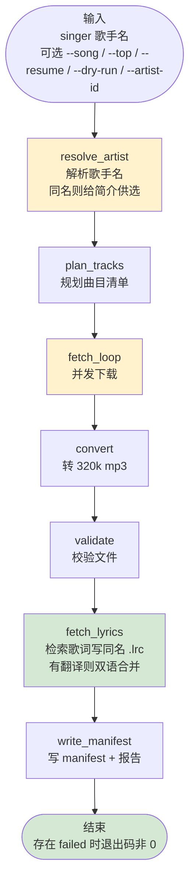
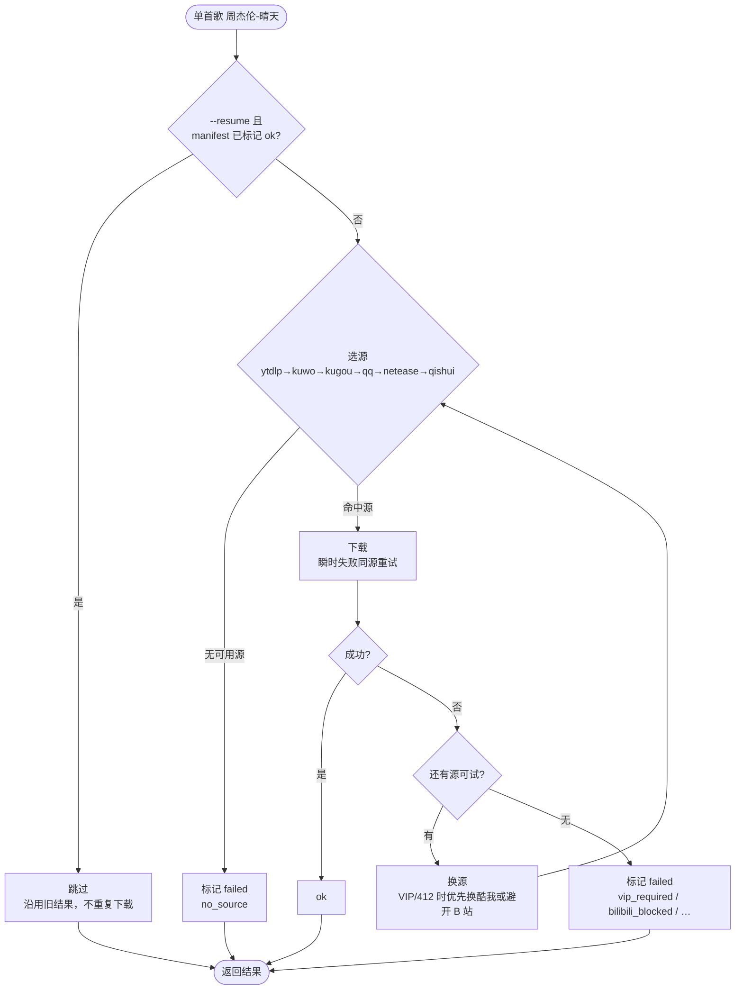

# 歌手歌库 Agent — 使用说明（USAGE）

> 面向使用者的操作手册：运行模式、工作流流程图、断点续跑机制、失败判定、常见排障。
> 安装见 `INSTALL.md`；架构与原理见 `README.md`。

---

## 1. 快速上手（三条最常用命令）

```bash
cd music-library-agent

# ① 抓某歌手 Top 30 热门歌
python main.py run --singer "周杰伦" --top 30

# ② 只抓指定单曲（--song 可写多次）
python main.py run --singer "周杰伦" --song "晴天" --song "稻香"

# ③ 上次中断了？断点续跑（已下完的不重复下）
python main.py run --singer "周杰伦" --resume
```

产出在 `music/<歌手>/` 目录，含音频文件（默认 320k `.mp3`）+ 同名 `.lrc` 歌词（默认同步检索）+ `manifest.json`（结果清单）。

---

## 2. 工作流程图

### 2.1 整体流程（LangGraph 状态机）



### 2.2 单首歌的下载决策（fetch_loop 内部）



> 选源与失败换源在有 `ARK_API_KEY` 时由 **LLM 决策**；无 key 时按固定规则（ytdlp → kuwo → kugou → qq → netease → qishui，剩余源逐个试；同源瞬时失败会指数退避重试）。

---

## 3. 运行模式详解

### 3.1 Top N 模式（默认）

```bash
python main.py run --singer "周杰伦" --top 30
```
- 从网易云搜索该歌手热门曲目，取前 N 首（`--top` 缺省 30）。
- 逐首下载 → 转 320k mp3 → 校验 → 写 manifest。

### 3.2 单曲模式（`--song`）

```bash
python main.py run --singer "周杰伦" --song "晴天"
python main.py run --singer "周杰伦" --song "晴天" --song "稻香"   # 多首
```
- 先在网易云按「歌手+歌名」精确匹配；命中则走网易云 id。
- 网易云未收录时**不会改下其它歌**，会保留用户指定歌名交给 **yt-dlp**（Bilibili；可选 YouTube）检索。
- 日志示例：`[plan_tracks] 网易云未收录，改由 yt-dlp 检索：...`

### 3.3 预览模式（`--dry-run`，不下载）

```bash
python main.py run --singer "周杰伦" --top 5 --dry-run
```
- 只做曲目发现，打印将抓哪些歌，**不实际下载**。用于先确认曲目对不对。

### 3.4 断点续跑模式（`--resume`）

```bash
python main.py run --singer "周杰伦" --resume
```
- 读取该歌手目录下的 `manifest.json`，**已标记 `ok` 的歌直接跳过、不重复下载**，只补 `failed` / `pending` 的歌。
- 适合上次下载到一半中断（Ctrl+C / 断网 / 关机）后接着跑。

### 3.5 同名歌手消歧

```bash
# 交互：打印每位同名歌手 ≤50 字简介（国籍/成立时间/代表作）
#   输入 1..N 或 artist-id 选定；输入 0（或「重新输入」）则换歌手名再检索
python main.py run --singer "Dear Jane" --top 5 --dry-run

# 非交互：直接指定网易云歌手 id
python main.py run --singer "Dear Jane" --artist-id 11378 --top 5 --dry-run
```
- 仅当网易云搜索出现**名称完全相同**的多个歌手时触发。
- 候选都不符合时选 **`0`**，按提示重新输入歌手名，会重新做同名检索与消歧。
- 选中后输出目录为 `music/<歌手>_<artist-id>/`，并按该 id 精确拉热门曲，避免同名串歌。
- 非 TTY（管道/CI）且未给 `--artist-id` 时退出码 `2`，并打印候选列表。

### 3.6 歌词同步检索（默认开启）

- 音频校验通过后，自动为该曲目检索歌词并写 **同名 `.lrc`**（如 `周杰伦 - 晴天.lrc`），与 mp3 同名，播放器会自动关联并滚动显示。
- 检索到翻译歌词（外语/部分粤语歌）时按时间轴合并为双语：`[00:12.34]原词 / 译文`。
- 仅对**最终下载成功**的曲目取歌词；歌词接口无需 cookie/VIP。
- 外源曲目（网易云未收录、走 yt-dlp 的歌）会按「歌手+歌名」搜索匹配同一首歌；兼容繁简体歌手名差异，匹配不到时不会用别的歌的歌词（`lyric_fail_reason=not_found`）。
- `.lrc` 已存在时不重复获取（resume 友好）。
- 关闭方式：单次加 `--no-lyrics`，或 `.env` 设 `MUSIC_ENABLE_LYRICS=0`。

```bash
python main.py run --singer "周杰伦" --top 30 --no-lyrics   # 本次只下音频不取词
```

---

## 4. 断点续跑机制（重点）

Agent 有**两层持久化**，对应两种"断点"：

### 4.1 文件级断点 —— `manifest.json`（每首歌一个状态）

每首歌在 `music/<歌手>/manifest.json` 里记录：

```json
{
  "summary": {"total": 3, "ok": 2, "failed": 1, "pending": 0},
  "results": {
    "347230": {"status": "ok",     "path": "...\\周杰伦 - 晴天.mp3", "format": "mp3", "source": "ytdlp",
               "lyric_status": "ok", "lyric_path": "...\\周杰伦 - 晴天.lrc", "lyric_source": "netease"},
    "5257138": {"status": "failed", "fail_reason": "vip_required", "title": "屋顶"},
    "509781655": {"status": "pending", "title": "想你就写信"}
  }
}
```

**状态机**：
```
pending ──下载成功──▶ ok
   │                   ▲
   └──下载失败──▶ failed ──(--resume 重试)──┘
```

**断点判断规则**（`fetch_loop` 节点）：
- 遍历本次要下的曲目，查 manifest：
  - `status == "ok"` → **跳过**（沿用旧结果，连文件都不再碰）
  - 其它（`failed` / `pending` / 无记录）→ **重新下载**
- 日志会提示：`[fetch_loop] resume：跳过已完成 N 首，待处理 M 首`

### 4.2 流程级断点 —— `SqliteSaver` checkpoint（整个 Agent 流程）

LangGraph 把每个节点的状态存到 `.music-agent/checkpoints.sqlite`。用于：
```bash
# 查看某歌手上次跑到哪了
python main.py state --thread-id music-周杰伦

# 从 checkpoint 原样续跑（一般不需要手动用，--resume 更直观）
python main.py resume --thread-id music-周杰伦
```

> **thread_id 说明**：
> - 普通 `run`：每次用带时间戳的 thread_id（全新会话，不受旧 checkpoint 干扰）。
> - `--resume`：复用固定 thread_id（`music-<歌手>`），从而能读到上次的 manifest 和状态。

**该用哪个？**
- 日常"上次没下完，接着下" → 用 `run --resume`（简单，按 manifest 跳过已完成的）。
- 排查"上次跑到哪个节点停了" → 用 `state --thread-id`。

---

## 5. 辅助命令

```bash
# 校验已下载文件是否都能正常打开（输出"可正常访问：N/M"）
python main.py verify --singer "周杰伦"

# 查看某歌手的 checkpoint 状态
python main.py state --thread-id music-周杰伦

# 指定 checkpoint 文件位置（默认 .music-agent/checkpoints.sqlite）
python main.py --db .music-agent/checkpoints.sqlite run --singer "周杰伦"
```

`verify` 对每首标记 `ok` 的歌检查：文件存在、大小 > 100KB、（能读到时长时）时长与元数据偏差 < 15s。存在不可访问的文件时**退出码非 0**。

---

## 6. 失败判定与退出码

### 6.1 单首歌的失败原因（`fail_reason`）

| fail_reason | 含义 | 建议 |
| --- | --- | --- |
| `no_source` | 无任何可用音源（yt-dlp 未装 且 网易云无 cookie） | 装 yt-dlp（见 INSTALL.md §5） |
| `vip_required` | 平台直链不可用（VIP/登录/版权） | 会自动换酷我/B站；或配对应 cookie（网易云/QQ） |
| `resource_not_found` | 未检索到与目标歌名匹配的资源（不会改下其它歌） | 核对歌手/歌名，或换源重试 |
| `ytdlp_error:...` | yt-dlp 下载失败（视频下架/解析失败/网络） | 看具体报错；可能换源重试已失败 |
| `bilibili_blocked:...` | B 站风控拦截（412 / 返回 HTML / JSON 解析失败） | 降并发、增大 `MUSIC_YTDLP_SLEEP_INTERVAL`、配 cookie；会换酷我等源 |
| `qq_error:...` | QQ 音乐下载失败 | 配 `MUSIC_QQ_COOKIE_FILE`，或依赖自动换源 |
| `cookie_file_missing:...` | 配置了 `MUSIC_YTDLP_COOKIE_FILE` 但文件不存在 | 检查 cookie 文件路径，或改用 `MUSIC_YTDLP_COOKIES_FROM_BROWSER` |
| `no_file` | yt-dlp 执行成功但目录里没产出文件 | 源站点行为异常，重试 |
| `resolve_error:...` | 网易云解析直链接口报错 | 网络或接口变动，重试 |
| `download_error:...` | 网易云直链下载过程出错 | 网络问题，重试 |
| `not_installed` | yt-dlp 未安装 | `pip install yt-dlp` |
| `too_small` | 校验时文件 < 100KB | 源文件异常，重试 |
| `duration_mismatch` | 时长与元数据偏差 > 15s | 可能下错版本，重试或手动核对 |
| `missing` | 校验时文件不存在 | 下载中断，重试 |

> 歌词的失败原因记录在 **`lyric_fail_reason`**（不覆盖音频的 `fail_reason`）：
> `not_found`（搜索不到同一首歌的歌词，含繁简体差异）、`no_lyric`（该条目确实无歌词）、`resolve_error:...`（歌词接口异常）。歌词失败不影响音频结果，可用 `--resume` 补取。

### 6.2 进程退出码

| 退出码 | 含义 |
| --- | --- |
| `0` | 全部歌曲下载成功且可访问 |
| 非 `0` | 存在 `failed` 或 `verify` 不通过的歌 → 用 `--resume` 补，或按 `fail_reason` 排障 |

---

## 7. 典型场景

**Q：上次下了 20 首，断了，想接着下。**
```bash
python main.py run --singer "周杰伦" --resume
# 日志：[fetch_loop] resume：跳过已完成 20 首，待处理 10 首
```

**Q：只想看看会抓到哪些歌，先不下载。**
```bash
python main.py run --singer "周杰伦" --top 30 --dry-run
```

**Q：某首歌一直是 vip_required。**
说明命中源需要 VIP/登录（网易云/酷狗/QQ/汽水常见）。Agent 会自动换酷我或 Bilibili；若仍失败：
- **推荐**：`python main.py login --platform netease`（或 bilibili / qq）唤起登录窗，登录后自动写 Cookie
- 或手动配 `NETEASE_COOKIE_FILE` / `MUSIC_QQ_COOKIE_FILE`
- 确认 `MUSIC_ENABLE_KUWO=1`、`MUSIC_ENABLE_YTDLP=1`
- 用 `--resume` 重试（瞬时失败会同源退避重试）

**Q：怎么自动获取 Cookie，不用手动从浏览器复制？**
```bash
pip install pywebview   # 若尚未安装
python main.py login --platform bilibili   # 弹窗登录 B 站
python main.py login --platform netease    # 弹窗登录网易云
python main.py login --platform qq         # 弹窗登录 QQ 音乐
# 或 GUI「在线检索」页点「B站 / 网易云 / QQ音乐 …」按钮
```
程序会后台轮询 Cookie，检测到登录凭证后写入 `.cookies/<平台>.txt`，并更新 `config.txt` 对应路径。

**Q：报 `bilibili_blocked` / 412 错误。**
B 站风控（并发过高、无 cookie、IP 临时限制）。处理：
```
MUSIC_CONCURRENCY=1
MUSIC_YTDLP_SLEEP_INTERVAL=3
MUSIC_FETCH_RETRIES=3
```
并配 B 站 cookie（`MUSIC_YTDLP_COOKIE_FILE` 或 `MUSIC_YTDLP_COOKIES_FROM_BROWSER=chrome`）。
412 会被判定为可重试，并优先换酷我/酷狗等源，不必死磕 B 站。

**Q：下载到一半想停，再启动会不会重复下？**
Ctrl+C 后用 `--resume`，已 `ok` 的不会重复下载。

**Q：LLM（Ark）没配会不会不能用？**
能用。LLM 只负责"歌手别名、选源、失败换源"的智能决策；没配 `ARK_API_KEY` 时自动降级为固定规则，功能完整。

**Q：不想下歌词 / 某首歌歌词没取到怎么办？**
单次跳过加 `--no-lyrics`；个别歌词失败不影响音频，之后 `--resume` 会只补未取到的歌词（已存在的 `.lrc` 不重复获取）。

---

## 8. 排障速查

| 现象 | 排查 |
| --- | --- |
| `下载完成 0/N` 全失败 | 看 manifest 里 `fail_reason`；大概率 `no_source`（装 yt-dlp）或 `vip_required`（配 cookie） |
| 下载卡住不动 | 网络问题；Ctrl+C 后 `--resume` |
| 一直是 `vip_required` | 网易云需 VIP；改用 yt-dlp（Bilibili 源） |
| `bilibili_blocked` / 412 | B 站风控；并发降到 1、加大 `MUSIC_YTDLP_SLEEP_INTERVAL`、配 B 站 cookie |
| `ytdlp_error:...timeout` | YouTube 不可达；代码默认走 Bilibili（YouTube 回退默认关闭），看 Bilibili 是否可访问 |
| 产出是 `.m4a` 不是 `.mp3` | ffmpeg 未就位；见 INSTALL.md §4 装到 `tools/ffmpeg/bin/` |
| `verify` 报某首不可访问 | 该首下载异常；`--resume` 重下或手动删 manifest 中该行再 `--resume` |
| 歌词没下到（`lyric_fail_reason` 非空） | 网络抖动或该版本无歌词；`--resume` 会自动补取，不影响音频 |

---

### 8.1 .env 高级配置（yt-dlp / B 站）

```bash
NETEASE_COOKIE_FILE=F:\secret          # 网易云 cookie 文件或目录（目录内找 wangyiyun.txt 等）
MUSIC_CONCURRENCY=1                    # 下载并发数（B 站易 412，默认 1；可 --concurrency 覆盖）
MUSIC_POOL=thread                      # thread=多线程 / process=多进程（可 --pool 覆盖）
MUSIC_YTDLP_SLEEP_INTERVAL=2           # 每次下载间隔秒数
MUSIC_YTDLP_SLEEP_REQUESTS=1           # 每几次请求后 sleep
MUSIC_YTDLP_COOKIE_FILE=               # B 站 cookie 文件（Netscape 格式）
MUSIC_YTDLP_COOKIES_FROM_BROWSER=      # 从浏览器导入 cookie，如 chrome / edge
MUSIC_YTDLP_ENABLE_YOUTUBE=0           # 是否启用 YouTube 回退（国内默认 0 关闭）
MUSIC_ENABLE_LYRICS=1                  # 同步检索歌词写同名 .lrc（默认 1；--no-lyrics 单次关闭）
```

---

## 9. 合规提醒

仅供个人学习与本地收藏，请尊重音乐版权，勿用于商业用途或公开传播。
